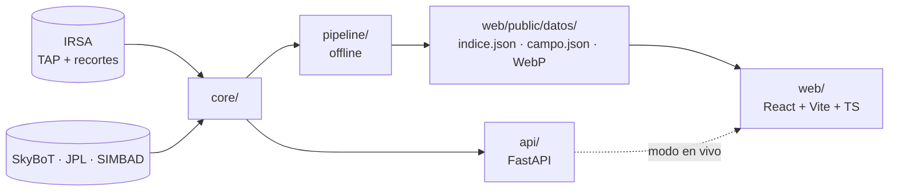
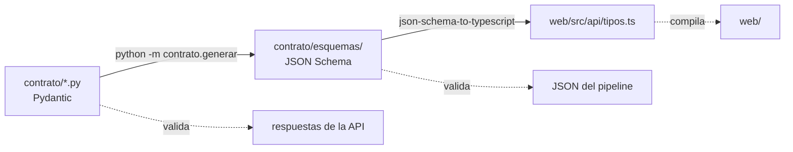

# spherex-blink

Herramienta web para ver cómo cambia el cielo infrarrojo entre las pasadas del
telescopio espacial SPHEREx sobre una misma región, y encontrar en esas
imágenes objetos que se mueven: estrellas cercanas con movimiento propio alto,
cuerpos del Sistema Solar y, como horizonte, un planeta lejano todavía no
descubierto. Usa datos reales del archivo de IRSA y muestra **candidatos**,
nunca descubrimientos. Es una entrega al desafío «Planet X and SPHEREx» de
NASA Space Apps 2026.

Hoy el repo tiene el esqueleto: el contrato de datos completo, una API con su
ruta de salud, la web con la página inicial y la verificación continua. El
pipeline de datos, el visor y la búsqueda de objetos se construyen sobre esta
base.

## Estructura

```
spherex-blink/
├── contrato/            Forma de los datos: modelos Pydantic, la única fuente de verdad
│   ├── comunes.py       Tipos compartidos (coordenadas, detector, texto traducido)
│   ├── indice.py        indice.json: la lista de campos
│   ├── campo.py         campo.json: un campo con sus épocas, objetos y candidatos
│   ├── api.py           Entradas y salidas propias de la API
│   ├── esquema.py       Exportación a JSON Schema
│   ├── generar.py       Comando que escribe los schemas y los tipos TS
│   ├── esquemas/        JSON Schema generados (versionados)
│   └── ejemplos/        indice.json y campo.json hechos a mano para las pruebas
├── core/                Lógica que comparten el pipeline y la API
├── pipeline/            Proceso offline que genera los campos de la demo
├── api/                 FastAPI: rutas HTTP que delegan en core/
│   └── rutas/           Un router por área
├── tests/               pytest, con una carpeta por paquete
├── web/                 React + Vite + TypeScript
│   ├── src/             Código de la aplicación (taxonomía abajo)
│   ├── e2e/             Pruebas en navegador con Playwright
│   ├── scripts/         generar-tipos.mjs (JSON Schema → TypeScript)
│   └── wrangler.toml    Configuración de Cloudflare Pages
├── .github/workflows/   verificacion.yml
├── pyproject.toml       Paquete Python, dependencias fijadas, ruff, mypy y pytest
├── LICENSE              MIT
└── CREDITS.md           Datos, código y librerías de terceros con su licencia
```

## Taxonomía

Todo lo propio se nombra en español (`escribir_documento`, `rutaDeDatos`,
`paginas/`); el sufijo técnico queda en inglés cuando es convención
(`router`, `fixture`).

**Python.** Cuatro paquetes con responsabilidades que no se cruzan:

| Paquete | Qué vive adentro | De qué depende |
|---|---|---|
| `contrato` | Modelos de datos y su exportación | Sólo Pydantic |
| `core` | Toda la lógica que toca datos | `contrato` |
| `pipeline` | Orquestación offline y escritura de archivos | `core`, `contrato` |
| `api` | Rutas HTTP, sin lógica | `core`, `contrato` |

Los tests espejan los paquetes en `tests/<paquete>/`. Los que pegan a servicios
reales llevan `@pytest.mark.red` y quedan fuera de la corrida por defecto.

**Web** (`web/src/`):

| Carpeta | Qué vive adentro |
|---|---|
| `main.tsx` · `App.tsx` | Arranque y, cuando haya más de una página, el router |
| `api/` | `tipos.ts`, generado desde el contrato (no se edita a mano), y el acceso a datos |
| `paginas/` | Una por ruta |
| `componentes/` | Piezas reutilizables, sin acceso a datos |
| `layout/` | Estructura común |
| `hooks/` | Hooks de datos y de comportamiento |
| `util/` | Funciones puras, sin React |
| `estilos/` | `tokens.css` (custom properties), `base.css` y una hoja por página |
| `test/` | Vitest, espejando las carpetas de arriba, más `fixture/` |

Las carpetas aparecen a medida que tienen contenido. CSS propio con tokens, sin
librerías de componentes.

## Arquitectura

Dos capas sobre el mismo núcleo. La **capa estática** es el producto mínimo: el
pipeline corre offline, baja los recortes de IRSA y deja cada campo de la demo
como archivos JSON + WebP en `web/public/datos/`; la web los lee sin otro
servidor y funciona sin red. La **capa en vivo** es un extra: la API usa el
mismo `core/` para armar un campo a pedido y lo devuelve con la misma forma.



### Flujo del contrato

La forma de los datos se define una sola vez, en Python, y de ahí sale todo lo
demás. Un cambio en un modelo que no regenere sus derivados no pasa la
verificación.



## Cómo se corre

Requisitos: Python 3.12 y Node 24.

### Python

```bash
python -m venv .venv
source .venv/Scripts/activate      # en Linux/macOS: .venv/bin/activate
pip install -e ".[dev]"

pytest                             # tests sin red
pytest -m red                      # sólo los que pegan a servicios reales
ruff check . && ruff format --check .
mypy

uvicorn api.app:app --reload       # API en http://127.0.0.1:8000/salud
```

### Web

```bash
cd web
npm ci
npx playwright install chromium    # una sola vez, para las pruebas en navegador

npm run dev                        # http://localhost:5173
npm run lint
npm run typecheck
npm test                           # Vitest
npm run build                      # deja la build en web/dist/
npm run test:e2e                   # Playwright contra la build servida
```

### Contrato

Después de cambiar un modelo de `contrato/`, desde la raíz y con el entorno de
Python activo (y `npm ci` hecho en `web/`):

```bash
python -m contrato.generar         # escribe contrato/esquemas/ y web/src/api/tipos.ts
```

Los generados se versionan junto con el cambio del modelo.

## Verificación continua

`.github/workflows/verificacion.yml` corre en cada PR a `develop` o `main` y en
cada push a esas ramas, con tres trabajos:

| Trabajo | Qué verifica |
|---|---|
| Python | ruff (lint y formato), mypy estricto y pytest |
| Contrato | Que los schemas y `tipos.ts` versionados coinciden con los modelos |
| Web | ESLint, `tsc`, Vitest, build y Playwright |

Ninguna prueba de la verificación hace pedidos a IRSA ni a los catálogos.

## Despliegue

La web se publica en **Cloudflare Pages** con la integración de Git: cada push
a `main` dispara una build nueva. Configuración del proyecto de Pages:

| Opción | Valor |
|---|---|
| Rama de producción | `main` |
| Directorio raíz | `web` |
| Comando de build | `npm run build` |
| Directorio de salida | `dist` (declarado también en `web/wrangler.toml`) |
| Versión de Node | la de `web/.node-version` |

`develop` es la rama de integración; `main` sólo recibe lo que sale a
producción, con una etiqueta de versión semver.

## Licencia y créditos

Código bajo licencia [MIT](LICENSE). Los datos son de SPHEREx/IRSA y los
catálogos citados; el detalle de datos, código y librerías de terceros está en
[CREDITS.md](CREDITS.md).
