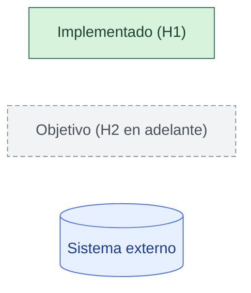
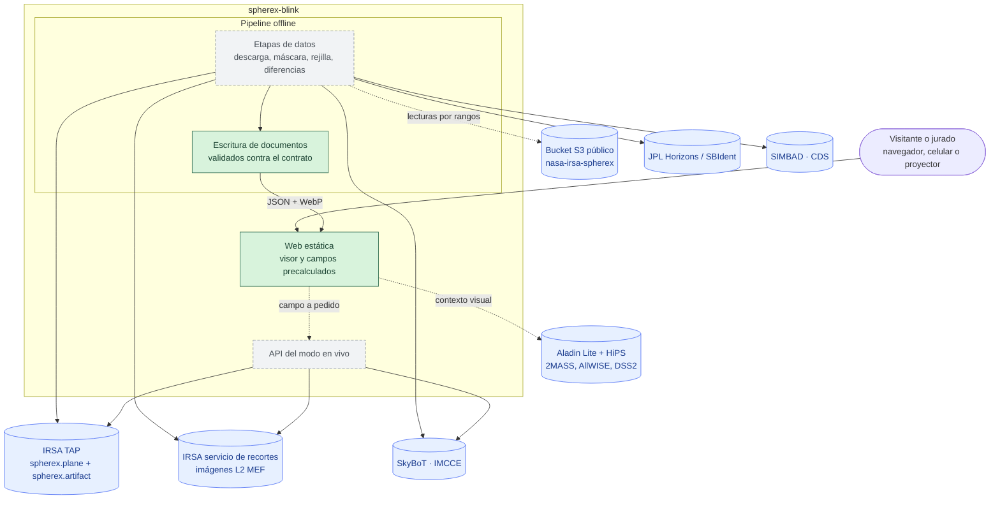
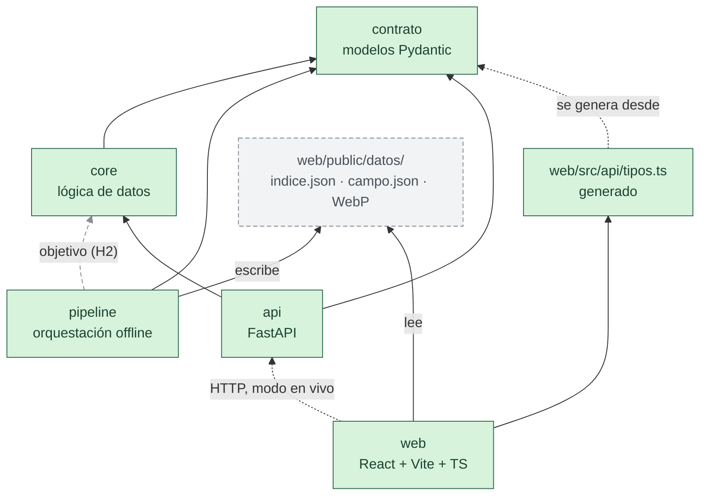
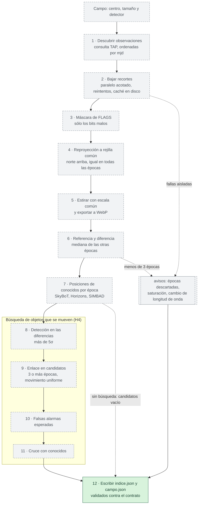
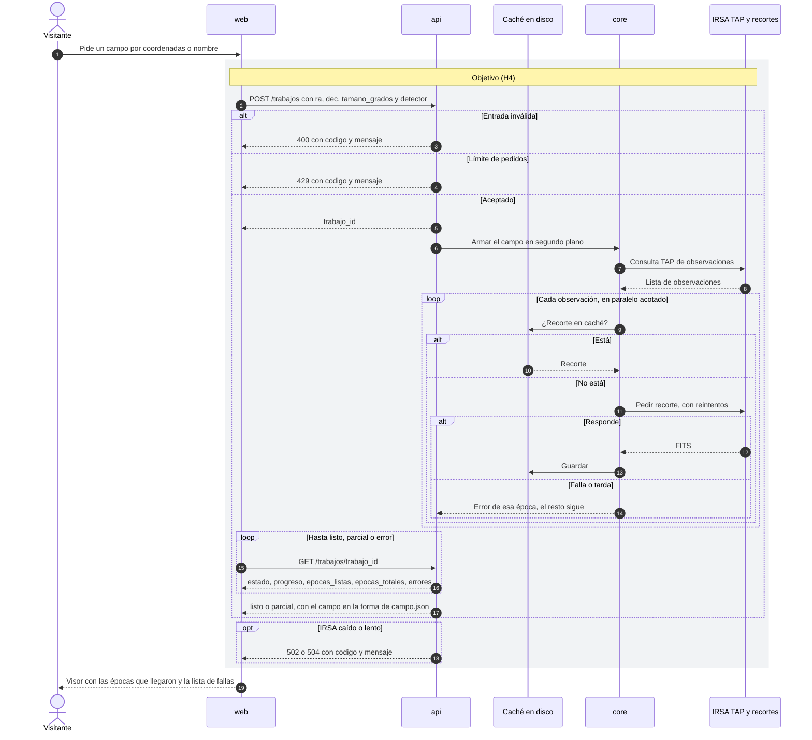
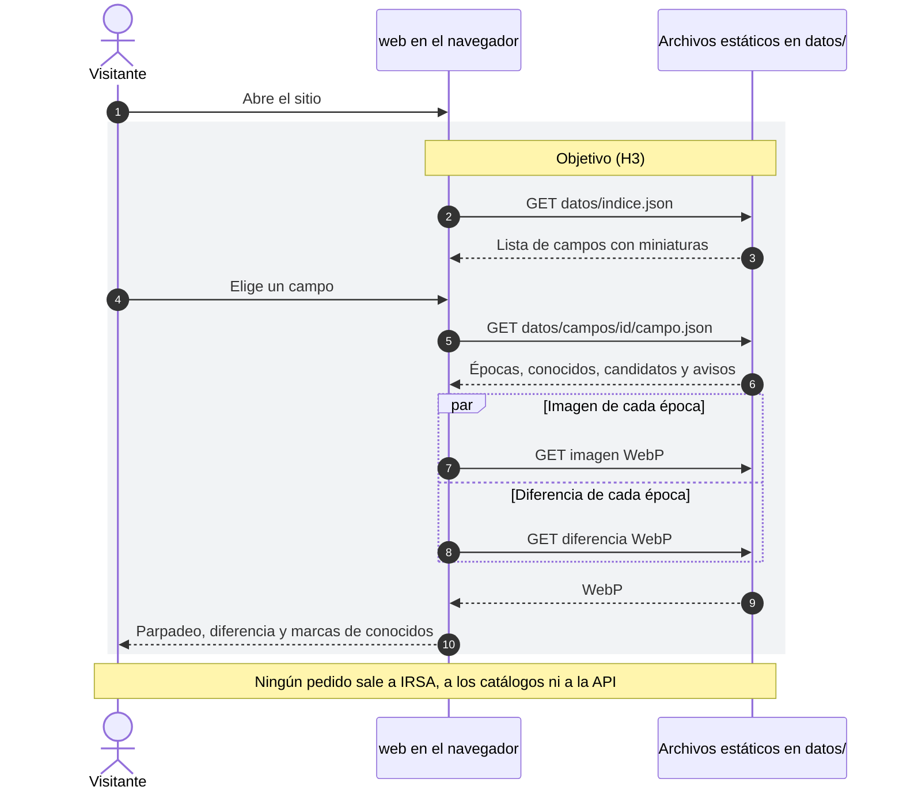
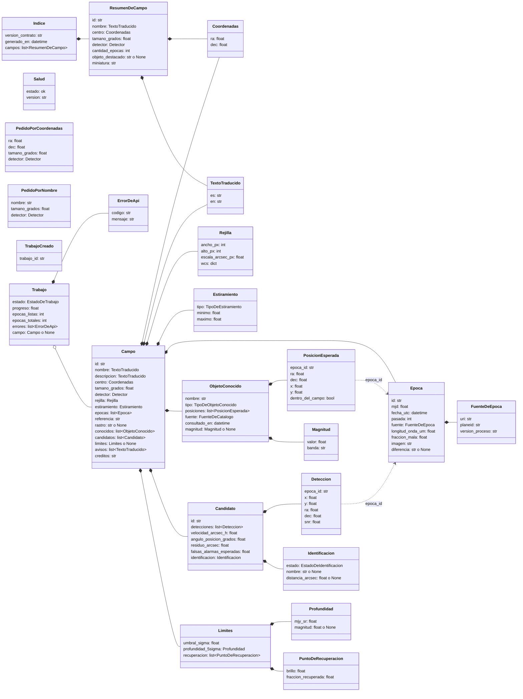
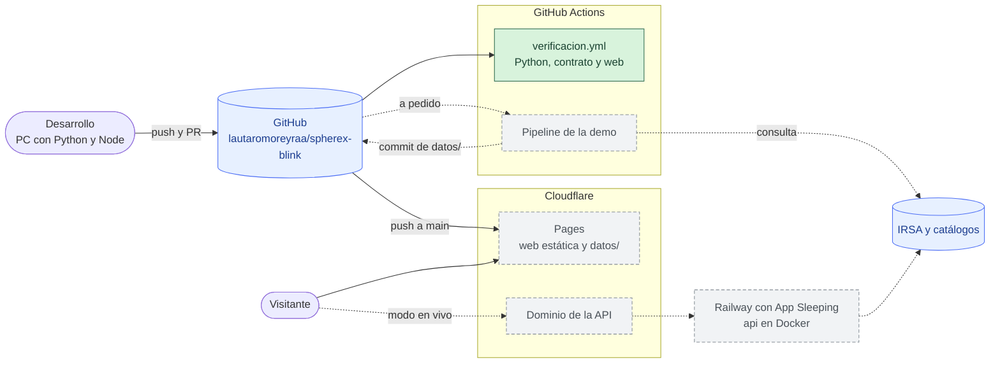
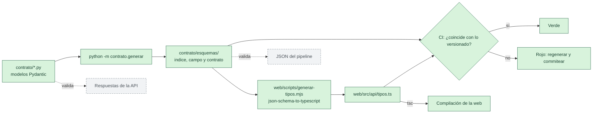
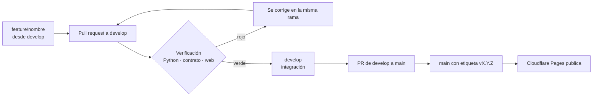

# spherex-blink

Herramienta web para ver cómo cambia el cielo infrarrojo entre las pasadas del
telescopio espacial SPHEREx sobre una misma región, y encontrar en esas
imágenes objetos que se mueven: estrellas cercanas con movimiento propio alto,
cuerpos del Sistema Solar y, como horizonte, un planeta lejano todavía no
descubierto. Usa datos reales del archivo de IRSA y muestra **candidatos**,
nunca descubrimientos. Es la base del proyecto para el desafío «Planet X and
SPHEREx» de NASA Space Apps 2026.

Este README explica el sistema con diagramas: primero el contexto y las
piezas, después cómo viajan los datos, y al final cómo se despliega y cómo se
trabaja.

## Qué está hecho y qué es objetivo

El repo tiene hoy el esqueleto (hito **H1**): el contrato de datos completo,
`core` con la versión y la salud del servicio, `pipeline` con la escritura de
documentos, `api` con `GET /salud`, la web con la página inicial y el pie de
reconocimientos, y la verificación continua. El resto de la arquitectura es el
**objetivo** de los hitos H2 a H5 y sale del plan del proyecto y de la
especificación de requisitos.

Los diagramas usan la misma leyenda:



En los diagramas de secuencia, los tramos objetivo van dentro de un recuadro
gris rotulado con su hito.

## Módulos

| Módulo | Responsabilidad | Stack | Estado |
|---|---|---|---|
| `contrato/` | Forma de los datos: única fuente de verdad para pipeline, API y web | Python 3.12, Pydantic → JSON Schema → json-schema-to-typescript | Completo |
| `core/` | Toda la lógica que toca datos: consultas a IRSA, máscaras, rejilla común, diferencias, objetos conocidos, búsqueda | Python 3.12, astropy, photutils, reproject, numpy, scipy, pyvo, httpx | Versión y salud; el resto desde H2 |
| `pipeline/` | Orquesta `core` offline y deja los campos de la demo como archivos estáticos | Python 3.12 | Escritura de documentos; el resto desde H2 |
| `api/` | Modo en vivo: rutas HTTP que delegan en `core`, con caché en disco | FastAPI, Uvicorn | `GET /salud`; el resto en H4 |
| `web/` | Visor: parpadeo, diferencia, objetos conocidos, candidatos, página de límites | React, Vite, TypeScript, CSS con tokens, canvas, Aladin Lite v3 | Página inicial y pie; el visor en H3 |

## Arquitectura

### 1. Contexto del sistema

Quién usa spherex-blink y con qué sistemas externos habla. Todos los datos
científicos salen de servicios públicos: IRSA para las imágenes de SPHEREx y
los catálogos de IMCCE, JPL y CDS para los objetos conocidos. El visitante sólo
habla con la web; la demo no necesita ninguno de los externos porque los campos
ya vienen precalculados. Del pipeline ya existe la escritura de documentos; las
etapas que bajan y procesan los datos llegan en H2.



### 2. Contenedores y dependencias entre paquetes

Las flechas apuntan hacia lo que cada paquete importa. `contrato` no depende
de nada del proyecto; `core` sólo de `contrato`; `pipeline` y `api` son dos
puertas distintas al mismo `core` y no se importan entre sí. Hoy `api` ya
importa `core`; `pipeline` sólo importa `contrato` hasta que lleguen las etapas
de datos en H2. La web no importa Python: compila contra los tipos generados y
lee el JSON que deja el pipeline o que devuelve la API.



| Paquete | Puede importar | No puede importar |
|---|---|---|
| `contrato` | Pydantic | `core`, `pipeline`, `api` |
| `core` | `contrato` y librerías científicas | `pipeline`, `api`, FastAPI |
| `pipeline` | `core`, `contrato` | `api` |
| `api` | `core`, `contrato`, FastAPI | `pipeline` |
| `web` | `src/api/tipos.ts` y los JSON | Ningún paquete Python |

### 3. Pipeline por etapas

Lo que hace `pipeline` con cada campo de la demo, en orden. Cada etapa es una
función de `core`, así la API reutiliza las mismas etapas para un campo en
vivo. La búsqueda de objetos que se mueven va aparte porque llega en H4 y la
demo funciona sin ella: hasta entonces `candidatos` queda vacío. Las fallas no
cortan el campo: terminan en `avisos[]`.



### 4. Secuencia de un campo en vivo

Cómo se arma un campo que no está en la demo. El pedido no espera al
resultado: devuelve un `trabajo_id` y la web pregunta el estado hasta que
termina, porque cada recorte de IRSA puede tardar varios segundos. Lo que
llegó se muestra aunque falten épocas (`parcial`) y las que fallaron quedan en
`errores`. Todo este flujo es objetivo de H4; hoy la API sólo responde
`GET /salud`.



### 5. Secuencia de la demo sin red

La demo no depende de internet: los campos están precalculados y se sirven
como archivos estáticos junto con la web. La web resuelve las rutas relativas
del contrato contra `datos/` (`util/rutas.ts`), así el mismo JSON sirve
publicado o servido localmente con `vite preview`.



### 6. Contrato de datos

Los modelos de `contrato/`, con los nombres y campos tal como están en el
código. `Indice` y `Campo` son la raíz de los dos archivos que produce el
pipeline; el resto son las entradas y salidas propias de la API. Todo este
diagrama está implementado.



Los tipos cerrados son literales: `Detector` va de `D1` a `D6`;
`TipoDeEstiramiento` es `lineal` o `asinh`; `TipoDeObjetoConocido` es
`estrella`, `asteroide`, `cometa`, `tno`, `planeta` o `enana-marron`;
`FuenteDeCatalogo` es `SkyBoT`, `Horizons` o `SIMBAD`; `EstadoDeIdentificacion`
es `conocido` o `sin-identificar`; `EstadoDeTrabajo` es `pendiente`,
`en-curso`, `parcial`, `listo` o `error`. `PedidoDeTrabajo` es
`PedidoPorCoordenadas` o `PedidoPorNombre`. Además de lo que dice el schema,
`Campo` valida que las épocas estén ordenadas por `mjd`, que sus `id` no se
repitan y que toda `epoca_id` citada exista.

### 7. Despliegue

Dónde corre cada pieza. La web es estática y la sirve Cloudflare Pages, que la
construye sola desde `main`. La API corre en Railway con App Sleeping (se
duerme sin tráfico, así el costo es cero) y se publica detrás de Cloudflare.
GitHub Actions verifica cada cambio y puede correr el pipeline para regenerar
los campos de la demo.



La configuración de Pages ya está en el repo (`web/wrangler.toml`,
`web/.node-version`); falta crear el proyecto, con estos valores:

| Opción | Valor |
|---|---|
| Rama de producción | `main` |
| Directorio raíz | `web` |
| Comando de build | `npm run build` |
| Directorio de salida | `dist` (declarado también en `web/wrangler.toml`) |
| Versión de Node | la de `web/.node-version` |

### 8. Flujo del contrato

Cómo se propaga un cambio en la forma de los datos. Se edita sólo el modelo
Pydantic; el JSON Schema y los tipos TS se generan y se versionan. La CI
regenera todo y falla si algo difiere de lo versionado, así un modelo nunca
llega a `develop` sin sus derivados.



### 9. Flujo de trabajo

Cómo entra un cambio. Cada trabajo va en una rama `feature/*` creada desde
`develop` y entra por PR, sólo con la verificación en verde. `main` recibe lo
que sale a producción, con una etiqueta semver, y es la rama que publica
Cloudflare Pages.



## Estructura

```
spherex-blink/
├── contrato/            Forma de los datos: modelos Pydantic, la única fuente de verdad
│   ├── comunes.py       Tipos compartidos (coordenadas, detector, texto traducido)
│   ├── indice.py        indice.json: la lista de campos
│   ├── campo.py         campo.json: un campo con sus épocas, objetos y candidatos
│   ├── api.py           Entradas y salidas propias de la API
│   ├── esquema.py       Exportación a JSON Schema
│   ├── generar.py       Comando que escribe los schemas y los tipos TS
│   ├── esquemas/        JSON Schema generados (versionados)
│   └── ejemplos/        indice.json y campo.json hechos a mano para las pruebas
├── core/                Lógica que comparten el pipeline y la API
├── pipeline/            Proceso offline que genera los campos de la demo
├── api/                 FastAPI: rutas HTTP que delegan en core/
│   └── rutas/           Un router por área
├── tests/               pytest, con una carpeta por paquete
├── web/                 React + Vite + TypeScript
│   ├── src/             Código de la aplicación (taxonomía abajo)
│   ├── e2e/             Pruebas en navegador con Playwright
│   ├── scripts/         generar-tipos.mjs (JSON Schema → TypeScript)
│   └── wrangler.toml    Configuración de Cloudflare Pages
├── .github/workflows/   verificacion.yml
├── pyproject.toml       Paquete Python, dependencias fijadas, ruff, mypy y pytest
├── LICENSE              MIT
└── CREDITS.md           Datos, código y librerías de terceros con su licencia
```

## Taxonomía

Todo lo propio se nombra en español (`escribir_documento`, `rutaDeDatos`,
`paginas/`); el sufijo técnico queda en inglés cuando es convención
(`router`, `fixture`).

**Python.** Cuatro paquetes con responsabilidades que no se cruzan:

| Paquete | Qué vive adentro | De qué depende |
|---|---|---|
| `contrato` | Modelos de datos y su exportación | Sólo Pydantic |
| `core` | Toda la lógica que toca datos | `contrato` |
| `pipeline` | Orquestación offline y escritura de archivos | `core`, `contrato` |
| `api` | Rutas HTTP, sin lógica | `core`, `contrato` |

Los tests espejan los paquetes en `tests/<paquete>/`. Los que pegan a servicios
reales llevan `@pytest.mark.red` y quedan fuera de la corrida por defecto.

**Web** (`web/src/`):

| Carpeta | Qué vive adentro |
|---|---|
| `main.tsx` · `App.tsx` | Arranque y, cuando haya más de una página, el router |
| `api/` | `tipos.ts`, generado desde el contrato (no se edita a mano), y el acceso a datos |
| `paginas/` | Una por ruta |
| `componentes/` | Piezas reutilizables, sin acceso a datos |
| `layout/` | Estructura común |
| `hooks/` | Hooks de datos y de comportamiento |
| `util/` | Funciones puras, sin React |
| `estilos/` | `tokens.css` (custom properties), `base.css` y una hoja por página |
| `test/` | Vitest, espejando las carpetas de arriba, más `fixture/` |

Las carpetas aparecen a medida que tienen contenido. CSS propio con tokens, sin
librerías de componentes.

## Cómo se corre

Requisitos: Python 3.12 y Node 24.

### Python

```bash
python -m venv .venv
source .venv/Scripts/activate      # en Linux/macOS: .venv/bin/activate
pip install -e ".[dev]"

pytest                             # tests sin red
pytest -m red                      # sólo los que pegan a servicios reales
ruff check . && ruff format --check .
mypy

uvicorn api.app:app --reload       # API en http://127.0.0.1:8000/salud
```

### Web

```bash
cd web
npm ci
npx playwright install chromium    # una sola vez, para las pruebas en navegador

npm run dev                        # http://localhost:5173
npm run lint
npm run typecheck
npm test                           # Vitest
npm run build                      # deja la build en web/dist/
npm run test:e2e                   # Playwright contra la build servida
```

### Contrato

Después de cambiar un modelo de `contrato/`, desde la raíz y con el entorno de
Python activo (y `npm ci` hecho en `web/`):

```bash
python -m contrato.generar         # escribe contrato/esquemas/ y web/src/api/tipos.ts
```

Los generados se versionan junto con el cambio del modelo.

## Verificación continua

`.github/workflows/verificacion.yml` corre en cada PR a `develop` o `main` y en
cada push a esas ramas, con tres trabajos:

| Trabajo | Qué verifica |
|---|---|
| Python | ruff (lint y formato), mypy estricto y pytest |
| Contrato | Que los schemas y `tipos.ts` versionados coinciden con los modelos |
| Web | ESLint, `tsc`, Vitest, build y Playwright |

Ninguna prueba de la verificación hace pedidos a IRSA ni a los catálogos.

## Licencia y créditos

Código bajo licencia [MIT](LICENSE). Los datos son de SPHEREx/IRSA y los
catálogos citados; el detalle de datos, código y librerías de terceros está en
[CREDITS.md](CREDITS.md).
